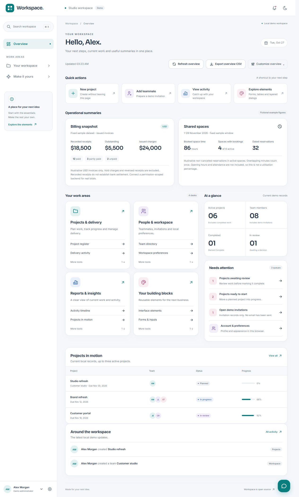
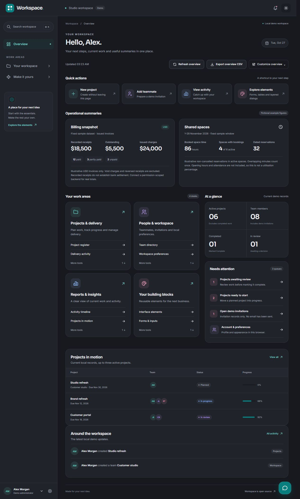
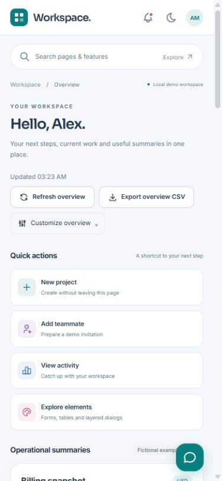
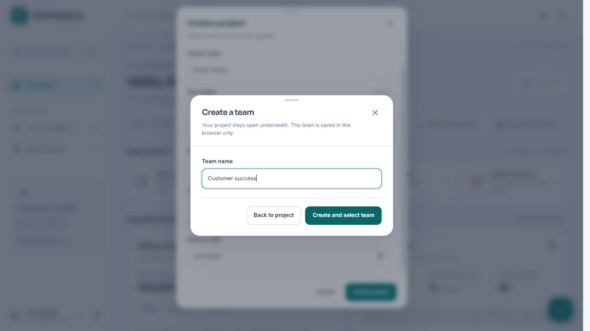

# Workspace Dashboard

A calm, rounded dashboard starter for your next business application. Built with **React, TypeScript, Vite and Tabler**, with a persistent sidebar, search-first mobile navigation and a useful collection of interface elements.

Use it for an internal tool, client portal, operations dashboard or your next product. Change the brand and navigation once, then build your business features inside the shared shell.

**[Live demo](https://imluri.github.io/workspace-dashboard/)** · **[Customisation](docs/CUSTOMISATION.md)** · **[Component guide](docs/COMPONENTS.md)** · **[MIT licence](LICENSE)**



<details>
<summary>Dark mode and mobile preview</summary>





</details>

<details>
<summary>Create a missing team without leaving your project draft</summary>



</details>

## What’s included

- A fixed header, persistent desktop sidebar and anchored account/settings menu.
- Compact work-area flyouts that keep a growing navigation rail manageable.
- Current overview controls, work desks, actionable queues, scoped example summaries and CSV export.
- Per-browser overview visibility preferences, with a restore action.
- Client navigation that changes the content area without refreshing the page.
- Rounded search modal with Ctrl/Cmd + K, keyboard navigation and page/section results.
- Mobile search navigation in place of a crowded sidebar.
- Light, dark and system appearance, plus teal, blue, violet and rose accents.
- Six example pages: Overview, Projects, People, Activity, Elements and Settings.
- Project creation, status changes, team invitations, filtering, grid/list views and CSV downloads using local demo data.
- Reusable buttons, fields, native dialogs, badges, avatars, progress bars, empty states and toasts.
- Velocity-preserving physical springs, subtle press feedback and layered native dialogs with reduced-motion support.
- Inline team creation above a project form, preserving the parent draft and selecting the created team.
- Responsive tables, tabs, accordions, switches, validation examples and cheerful pastel cards.
- A resizable, expandable guide panel with Enter-to-send and contextual section links.
- Self-hosted Inter and Sora fonts, local persistence, reduced-motion support and a production build workflow.

The guide uses a small local navigation matcher. It has **no AI service connection**. Invitations do not send email, and sample roles do not grant real permissions.

## Start locally

Use **Node.js 22.22+** (Node 24 is used in CI).

```sh
npm ci
npm run dev
```

Open the local URL printed by Vite. No credentials or environment variables are needed.

```sh
npm run check         # TypeScript checks
npm run build         # TypeScript + production build
npm run preview       # Serve the production build locally
npm run format        # Format source and docs
npm run format:check  # Check formatting
```

## Make it yours

1. Choose **Use this template** on GitHub, or clone this repository.
2. Update the name, navigation, search features and repository link in [`src/config.ts`](src/config.ts).
3. Adjust colour, radius, typography and shell sizing in [`src/styles/tokens.css`](src/styles/tokens.css).
4. Replace the example routes in [`src/App.tsx`](src/App.tsx) and pages in `src/pages/`.
5. Replace [`src/store.tsx`](src/store.tsx) with your own application state or service adapters.

The default workspace/profile values live in `src/store.tsx`. Settings are saved to this browser; they are not a substitute for your application’s account settings API.

### Add a page

```tsx
// src/pages/Customers.tsx
import { Card, PageHeading } from '../components/ui';

export function Customers() {
  return (
    <>
      <PageHeading
        eyebrow="Your business"
        title="Customers"
        description="A clear home for customer relationships."
      />
      <Card>Your customer interface goes here.</Card>
    </>
  );
}
```

Register `<Route path="customers" element={<Customers />} />` under `AppShell` in `App.tsx`, then add a navigation entry in `config.ts`. It becomes searchable automatically. See the [full guide](docs/CUSTOMISATION.md) for section links, theming and integrations.

## Project structure

```text
src/
  config.ts                  Brand, navigation and feature search
  data.ts                    Fictional typed sample records
  store.tsx                  Demo state, preferences, toasts and CSV export
  App.tsx                    Routes and recovery boundary
  components/
    AppShell.tsx             Persistent header, sidebar and content outlet
    CommandSearch.tsx        Shared keyboard/search navigation
    GuidePanel.tsx           Resizable local demo helper
    RecordDialogs.tsx        Example project and team forms
    ui.tsx                   Reusable interface primitives
    GroupedNavigation.tsx    Compact navigation flyouts
  lib/motion.ts              Shared physical spring and modal stack controller
  pages/                     Six working example pages
  styles/
    tokens.css               Theme and layout foundations
    dashboard.css            Components and responsive layouts
    workspace-current.css    Current overview, work desks and layered UI
```

## Deploy

`npm run build` writes a static site to `dist/`. Serve that folder with GitHub Pages, Railway, Cloudflare Pages, Netlify, Vercel or another static host. No application server or database is required for this demo.

Routes use `HashRouter` by default (`/#/projects`), and Vite uses a relative asset base. This supports static subdirectory hosting without route rewrites. To use clean URLs, switch to `BrowserRouter` and configure your host to serve `index.html` for application paths. See [deployment details](docs/CUSTOMISATION.md#deployment).

The included GitHub Pages workflow is manual. In a new repository, select **Settings → Pages → Source: GitHub Actions**, then run **Deploy demo to Pages** from Actions. The build workflow runs on pushes and pull requests.

## Demo boundaries

Everything is fictional and stored in this browser under `workspace.demo.v1`, `workspace.preferences.v1` and `workspace.overview.hidden.v1`. **Settings → Reset demo** restores the starting records, teams, preferences and overview visibility. Conversations in the guide are kept only while the app is open. Billing and shared-space figures are fixed, clearly labelled illustrations; project and people indicators reflect the local demo records.

This project provides frontend layouts and interactions. Before using it for real records, connect your own backend, authentication, authorisation, validation, uploads and service integrations. Keep API secrets on the server. There are no credentials, analytics, production records or private brand assets in this repository.

## Contributing

Small, focused improvements are welcome. See [CONTRIBUTING.md](CONTRIBUTING.md) for structure and review expectations. Security-related reports should follow [SECURITY.md](SECURITY.md).

## Licence & credits

Original starter code and artwork are released under the [MIT licence](LICENSE). Built with [Tabler](https://tabler.io/), [Tabler Icons](https://tabler.io/icons), [React](https://react.dev/), [React Router](https://reactrouter.com/) and [Vite](https://vite.dev/). Fonts are distributed under the SIL Open Font License. See [third-party notices](THIRD_PARTY_NOTICES.md).

Motion principles are inspired by [Justin’s iOS interaction article](https://blog.justinbuilds.mov/ios/): damped physical springs, preserving velocity during retargeting and bounded resistance on dedicated modal handles. The implementation is local TypeScript with no animation dependency. See [motion and layered dialogs](docs/MOTION.md).
